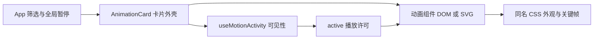

# 第 00 章 先让一个动画跑起来

先把九张卡片跑出来，再挑一个最简单的例子修改。能看见修改前后的差别，后面的坐标、关键帧和状态就有了具体对象。

## 运行前要有这些东西

使用 Node.js 24，或者项目 README 支持的 Node.js 版本。在仓库根目录执行下面两条命令。

```bash
npm ci
npm run dev
```

打开终端显示的地址。你应该能看到九张动画卡片，点击卡片右下角的代码按钮，可以切换 TSX 和 CSS 文件。若终端提示端口占用，以它给出的实际地址为准。

暂时看不到动画时，先确认页面没有暂停，系统也没有开启减少动态效果。此项目会遵循系统偏好，静态画面也属于正常结果。

## 顺着一个动作找代码

以信封为例，[FloatingMail.tsx](../../src/animations/FloatingMail.tsx) 创建信封和标签两个元素。[FloatingMail.css](../../src/animations/FloatingMail.css) 给它们画出外观并安排浮动。暂停、重播按钮属于 [AnimationCard.tsx](../../src/components/AnimationCard.tsx)。



这张图也解释了复制组件时最常见的遗漏。只复制 `FloatingMail.tsx` 和 CSS，能得到信封动画；离屏暂停还需要外壳和相关 Hook。CSS 动画从父元素的 `data-paused` 样式获得暂停状态，JS 时间轴和 Lottie 则接收播放参数。具体连接方式见[第 10 章](10-playback-and-quality.md)。

## 先分清两种百分比

本项目大量元素用下面这组写法居中。

```css
left: 50%;
top: 50%;
transform: translate(-50%, -50%);
```

`left` 和 `top` 把元素左上角放到包含块的中心。后面的位移，再把元素向左、向上移动自身参考框的一半。对于这里使用默认变换参考框的普通 HTML 元素，可以按元素自己的宽高理解。

因此，把 `translateY(-50%)` 改成 `translateY(-54%)`，增加的上移量是元素参考框高度的 4%。手机高度为 112px 时，这部分约为 4.48px。它与舞台的 258px 高度没有同样的比例关系。百分比的正式定义见 [MDN translateY](https://developer.mozilla.org/en-US/docs/Web/CSS/Reference/Values/transform-function/translateY)。

`transform` 中函数的顺序也影响结果。先建立居中位移，再改变内部图形的旋转，通常容易阅读。修改顺序前，先在浏览器里观察旋转中心和路径。

## 关键帧提供位置，缓动决定怎么经过

下面是一个练习片段，复制到新建的 CSS 示例时，需要自行给 `.floating-demo` 设置宽高和背景。

```css
.floating-demo {
  animation: small-float 5s ease-in-out infinite;
}

@keyframes small-float {
  0%,
  100% {
    transform: translateY(0);
  }
  50% {
    transform: translateY(-7px);
  }
}
```

一轮持续 5 秒。元素先上移 7px，再回到起点。`ease-in-out` 让每段动作的起步和收尾慢一些。把周期改成 8 秒，会减慢节奏；把位移改成 3px，会减小幅度。两项控制的东西不同，练习时分开改。

只有悬停时改变目标值的效果，通常用 `transition` 比较直观。需要持续循环或多个指定时刻的动作，就看 `@keyframes`。本项目的卡片轮转还要安排层级和阶段，所以使用了 JS 时间轴。CSS 动画各项设置可查 [MDN CSS 动画指南](https://developer.mozilla.org/en-US/docs/Web/CSS/Guides/Animations/Using)。

## 给容器一个明确的高度

多数动画根元素使用 `height: 100%`。单独引用时，父元素需要确定高度，否则你可能得到一个高度为零的舞台。

下面这个组件可以作为最小使用例子，导入路径按文件位置调整。

```tsx
import { TelegramSignal } from './animations/TelegramSignal'

export function Demo() {
  return (
    <div style={{ height: 258, borderRadius: 16, overflow: 'hidden' }}>
      <TelegramSignal />
    </div>
  )
}
```

先保持 258px，确认动画完整，再尝试更矮的容器。绝对定位的图形不会自动把父元素撑高，边缘被裁切时也要一起检查 `overflow`。

## 单独复用时把依赖带齐

| 动画               | 除 TSX 与 CSS 以外还需要什么                                                          |
| ------------------ | ------------------------------------------------------------------------------------- |
| CardDeck           | `src/lib/subscription-motion.ts`                                                      |
| ClaudeField        | 本地 `public/brands/claude.svg`，并调整 CSS 中的相对路径                              |
| GeminiOrbit        | 与 Duo 共用的 Membership 文件目前引用 DuoPlayer，复制时一起处理这项依赖，或先拆分文件 |
| DuoScene           | DuoPlayer、Lottie 类型声明、`lottie-web` 依赖，以及 JSON 和 SVG 海报                  |
| 自动暂停与静态模式 | useMotionActivity、相应外壳逻辑，以及暂停和减少动态效果样式                           |

## 先做一次小改动

在信封 CSS 里，把 `store-envelope-float` 的上移量从 `-7px` 改成 `-3px`。保留标签参数，观察主体与标签的相对运动。随后恢复原值，确认自己能找到真正控制这段动作的声明。

交给 AI 时，可以直接使用下面的要求。

```text
请先阅读 src/animations/FloatingMail.tsx 和 FloatingMail.css。
只把信封主体的最大上移量从 7px 改成 3px，保持 5s 周期和原有旋转角度。
标签动画、图形尺寸和页面布局保持原样，不增加依赖。
修改后列出具体选择器和数值变化，运行 npm run build。
如果没有浏览器验证条件，请明确说明，别把构建通过写成视觉效果已验证。
```

[返回目录](README.md) · [下一章 层叠之间](01-card-deck.md)
