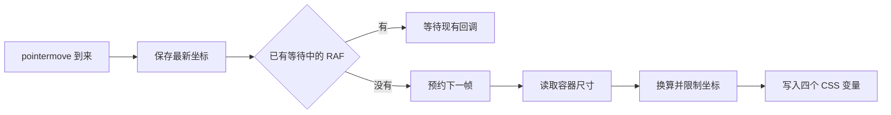

# 第 04 章 代码微光怎样跟随指针

在终端卡片上快速移动指针，准星和光圈会移动，终端本身只轻轻偏移。这个例子把高频输入与画面更新分开处理，适合拿来学习指针交互。

对应文件是 [CodeWorkspace.tsx](../../src/animations/CodeWorkspace.tsx) 和 [CodeWorkspace.css](../../src/animations/CodeWorkspace.css)。读到结尾，你可以给终端增加一个可控的位移幅度，同时保留它原来的浮动。

## 一次移动经过哪些步骤

组件用三个 ref 保存东西。`art` 指向动画容器，`pointer` 保存最近一次指针坐标，`frame` 记录已经预约的 RAF 回调。



在下一帧到来前，即使指针触发多次移动事件，代码也只保留一份最新坐标。已有回调会处理它，不再为每个事件分别预约。

RAF 只预约一次回调。这个组件在输入发生时预约下一帧，没有一直运行的逐帧循环。屏幕刷新频率也未必是 60Hz，因此文档和提示词应写“每帧合并更新”，不要写成“保证每秒执行 60 次”。参见 [MDN requestAnimationFrame](https://developer.mozilla.org/en-US/docs/Web/API/Window/requestAnimationFrame)。

## 坐标为什么要限制范围

核心计算可以缩成下面两步。这里只摘出 x 轴，y 轴相同。

```ts
const raw = ((point.x - rect.left) / Math.max(1, rect.width)) * 100
const x = Math.max(0, Math.min(100, raw))
```

减去 `rect.left` 后，得到相对容器左边缘的距离。除以宽度，再乘 100，就变成百分比。`Math.max(1, rect.width)` 防止特殊情况下除以零，最后的夹取让结果留在 0 至 100。

离开容器时，`pointer` 被设为 `null`。回调看到这个值，就把坐标恢复为 50。光圈与准星回到中心，终端位移也归零。

## 终端为什么比光圈移动得少

容器保存了两类变量。

| 变量                               | 用途                                   |
| ---------------------------------- | -------------------------------------- |
| `--code-x`、`--code-y`             | 指针的百分比位置，控制光圈、准星和渐变 |
| `--code-shift-x`、`--code-shift-y` | 终端位移，单位为 px                    |

终端位移按 `(x - 50) * 0.16` 计算。因此 x 为 0、50、100 时，结果分别是 -8px、0px、8px。这里的 0.16 表示每个百分点对应多少像素，与舞台宽度百分比不是同一种单位。

这个范围足够让人看出跟随，又不至于把终端推到舞台边上。`.toFixed(2)` 只控制写进样式的数字精度，平滑感主要来自更新节奏与各层过渡。

## 自动浮动和指针位移怎样共存

终端的关键帧中一直带着指针变量。

```css
transform: translate(calc(-50% + var(--code-shift-x)), calc(-50% + var(--code-shift-y)))
  rotate(-3deg);
```

在关键帧中点，垂直居中部分改为 `-53%`，角度改为 0 度。变量仍被保留，所以指针移动不会取消自动浮动。

如果把指针位移另写成一条直接覆盖 `transform` 的声明，就要重新处理它与关键帧的关系。当前写法将两种位移放进同一个表达式，读代码时可以清楚看到它们怎样相加。

光圈的坐标过渡为 0.14s，准星为 0.1s。它们会稍晚到达目标，终端则按自己的变量和 5.6s 浮动周期变化。背景网格每 10s 移动一个 24px 网格单元，文字光标用 `steps(1, end)` 做离散闪烁。

## 减少 React 更新不等于没有渲染成本

这里每帧通过 `style.setProperty` 写变量，避免了为每次指针移动触发 React 重渲染。但变量仍影响背景、遮罩以及光圈的 `left`、`top`，浏览器还要处理对应样式和绘制。

是否需要优化，要在目标设备上观察。若多个实例同时移动就卡顿，可以先测量，再考虑缩小光晕范围或改写移动方式。不要仅凭用了 RAF 就宣称已经解决全部性能问题。

组件卸载时会取消尚未执行的 RAF，防止回调继续操作离开的元素。单独复制组件时，也要带上这段清理。

## 练习把幅度变成参数

增加 `maxShift`，默认 8px。将坐标范围 -50 至 50 归一化后乘以它，避免让调用者接触 0.16 这个换算系数。试用 4px 和 8px 两种幅度，确认只影响终端。

```text
请在 src/animations/CodeWorkspace.tsx 增加可选参数 maxShift，默认值为 8，单位为 px。
先阅读现有指针归一化和 RAF 合帧代码，再将终端位移改为使用此参数。
x、y 在 0 至 100 时，终端位移应限制在 -maxShift 至 maxShift；离开后归零。
保留光圈、准星和背景的完整指针范围，以及 CSS 自动浮动。
不修改其他动画，不增加依赖。检查 maxShift 为 0、4、8 的结果，运行 npm run check。
提交修改摘要，区分数学检查与实际浏览器检查。
```

[返回目录](README.md) · [下一章 一声 Hello](05-duo-lottie.md)
