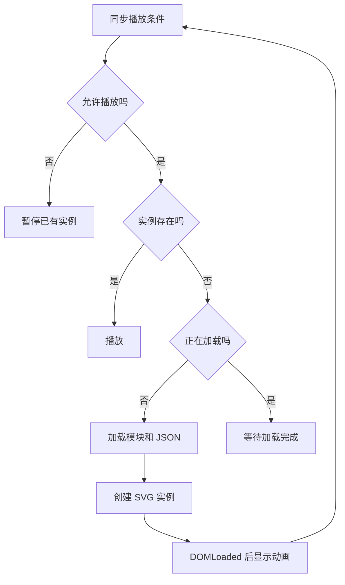

# 第 05 章 一声 Hello 的 Lottie 生命周期

Duo 的动作保存在 JSON 中，React 负责决定什么时候加载、播放和暂停。学习这张卡片时，先关注播放器与页面怎样配合，角色的每条曲线不需要手工重写。

需要一起看 [DuoPlayer.tsx](../../src/animations/DuoPlayer.tsx)、[Membership.tsx](../../src/animations/Membership.tsx) 和 [Membership.css](../../src/animations/Membership.css)。本地 JSON、海报及来源说明位于 [素材目录](../../public/brands/) 和 [ATTRIBUTION.md](../ATTRIBUTION.md)。

## 文件中的帧数能告诉我们什么

当前 JSON 的 `fr` 为 30，`ip` 为 130，`op` 为 290，画面尺寸为 560 × 480。这个区间长度为 160 帧，名义循环时长约为 `160 / 30 = 5.33` 秒。

它描述的是素材时间轴。页面可以暂停，播放器也受运行环境影响，所以这里的时长不等同于用户从打开页面到看完动作的总时间。

组件使用 Lottie 的 light SVG 播放器。素材没有在每次播放时从品牌网站下载，JSON 与海报都从本项目提供。替换素材时，要确认新文件使用的功能能被所选播放器支持，并处理相应素材许可。

## 海报先显示，动画准备好再接替

初始 `ready` 为 false。海报可见，播放器容器透明。`DOMLoaded` 事件到来后，组件将 `ready` 改为 true，CSS 再隐藏海报、显示 SVG。

这比只判断请求成功更可靠。拿到 JSON 仅代表数据已到达，播放器还需要创建画面。若加载失败，现有海报保持可见。

系统开启减少动态效果时，即使播放器曾经加载完成，媒体查询也会让海报重新显示，并隐藏播放器。这一步与暂停实例配合，得到稳定的静态图形。

## 为什么要有一个 sync 函数

`sync` 把几个条件集中判断。减少动态效果、页面隐藏、`visible` 为 false，任一条件成立就暂停；条件允许且实例已经存在就播放；还没有实例且尚未加载时才开始加载。



`visibility` ref 保存最新的外部参数。另一个 Effect 更新它并调用 `synchronize.current()`，播放器实例因此不必随着每次可见性变化重新创建。

## 并行加载也需要考虑离开页面

`Promise.all` 同时加载播放器模块与 JSON。两者都准备好以后，才调用 `loadAnimation`。这里设置了 `autoplay: false`，真正开始播放仍由 `sync` 决定，避免素材刚加载完就忽略页面当前的暂停状态。

组件卸载时会发生几件不同的清理。`AbortController` 取消仍在进行的 fetch，`disposed` 阻止迟到的异步回调继续创建实例，事件监听被移除，已有动画调用 `destroy()`。

动态 import 不能靠这个 AbortController 取消，所以仍需要 `disposed`。即使 fetch 已完成，组件也可能在 `response.json()` 或播放器初始化期间离开。检查放在实例创建前，可以挡住这类情况。Effect 的创建与清理关系可对照 [React useEffect 文档](https://react.dev/reference/react/useEffect)。

## 当前实现的回退与限制

加载失败会保留海报，但当前实例不会自动再次尝试加载，因为 `loading` 已经设为 true。画廊的重播会改变组件 key，销毁并重新挂载，因此可以触发新一轮尝试。若以后加入“重试”按钮，应明确它与“从头播放”的区别。

`setSubframe(false)` 让播放器按素材帧处理，避免额外的子帧插值。它没有给浏览器建立一个独立的精确 30Hz 定时器。

每个挂载的播放器各自管理加载。浏览器通常会缓存已下载的资源，但这段组件代码没有实现跨实例共享的 JSON 缓存。不要把网络缓存和组件内缓存混为一件事。

## 练习替换为自己的素材

准备一份你有权使用的 Lottie JSON 和对应海报。先检查宽高比，再替换路径。播放器的 `preserveAspectRatio: 'xMidYMid meet'` 会保持比例居中，比例差异可能留下空白。

然后验证慢速加载、请求失败、切换标签页和组件快速卸载。失败时应该仍有海报，重新挂载后不应出现两个 SVG 实例。

```text
请把 src/animations/DuoPlayer.tsx 整理成可传入 animationPath 和 posterPath 的本地 Lottie 播放器。
保留现有默认素材、light SVG 按需加载和 autoplay false 的流程。
明确路径按 Vite BASE_URL 解析，确保根目录与子目录部署都可用。
保留离屏暂停、document.hidden、减少动态效果、AbortController 和 destroy 清理。
不要增加外部素材链接或新播放器依赖。
运行 npm run check，并检查加载失败、快速卸载重挂载及静态模式；未执行的检查单独列出。
```

[返回目录](README.md) · [下一章 讯息涟漪](06-telegram-signal.md)
